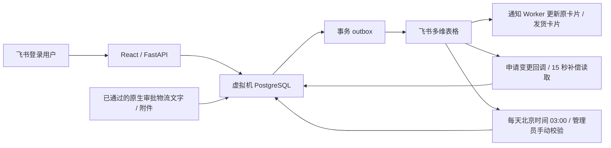

> **当前生产：V4.2.3（2026-10-30）**，Ubuntu 虚拟机 + PostgreSQL + 飞书同步。
> 本页位于默认分支 `master`。开发和部署使用 [`codex/postgres-core`](https://github.com/G1026271140-spec/pudu-material-operations/tree/codex/postgres-core)；默认分支其他文件保留历史版本。
> 最新调整：下单分装日历区分有无印刷物料并默认隐藏无印刷申请；修复生产 Worker 的 Excel 临时目录。

# PUDU Material Operations

PUDU 营销物料管理系统。当前为 **Ubuntu 虚拟机 + PostgreSQL + 飞书多维表格同步**的正式运行系统，前端使用 React / TypeScript，后端使用 FastAPI，业务、数据同步与卡片通知由独立 Worker 处理。

- **业务入口**：[materials.pudu.work](https://materials.pudu.work)
- **运维与开发入口**：[docs/ops/README.md](https://github.com/G1026271140-spec/pudu-material-operations/blob/codex/postgres-core/docs/ops/README.md)
- **开发约束**：[AGENTS.md](https://github.com/G1026271140-spec/pudu-material-operations/blob/codex/postgres-core/AGENTS.md)
- **实际线上版本**：[健康接口](https://materials.pudu.work/api/health)；源码版本为 `app.py` 中的 `APP_VERSION`。本文按当前 PostgreSQL 生产架构和业务规则维护，发布后以接口和 Git SHA 为准。

## 当前数据流程



日常操作先在本地事务中保存业务、审计、幂等结果和待同步任务，页面随即读取 PostgreSQL 的最新数据；Worker 再将变动写入对应飞书表。飞书暂不可达时，已保存数据和同步任务保留，不能把“入队”当作“已同步”。页面不依赖定时业务缓存文件。

申请明细同步按同业务批次 / 同申请合并，每批最多 50 条，正常更新一次批量读取加一次批量写入；逐条任务和审计保留。创建按编号查重，响应按编号 / 记录 ID 对应，超时先核对来源；审批仍须等全量明细及关联完整后触发。

管理、配货等队列接口持久化任务后立即返回，HTTP 请求不执行 Worker；库存 / 权限 / 额度等业务校验保留在相应事务和后台执行中。通讯录、兑换及飞书回调外部读取有独立执行线程，不占普通管理任务线程。

申领图片的附件关联来自 PostgreSQL，图片文件在 VM 的 `shared/media/image-assets` 预先生成 WebP，按附件令牌或本地内容摘要更新。物料、文化周边和文化衫共用文件读取与独立图片线程池；首次缺文件时补取，后台每 60 秒检查新图片。只缓存版本化图片文件，库存、额度和申请 JSON 保持实时读取。

每天 **03:00 Asia/Shanghai** 完整读取两套飞书来源的 23 张表，以飞书为准核对并更新本地，包括人工修改和清空。字段数量和定义以 `config/feishu_field_registry.json` 及数据库元数据为准；字段新增或类型变化必须同时维护注册和数据库迁移，不能跳过 schema 检查。

## 主要功能

- 普通物料申请、文化周边申领、企业文化衫申领，库存、个人额度及审批 / 发放流程。文化周边的夹克仅向飞书通讯录部门为市场营销部、Dream组或品牌部的人员显示并开放申领，后台同样按通讯录部门 ID 校验，不以表单部门文字或管理员角色绕过。
- **配货与发货**：配货工作台（待核实申请按提交日期分组，自定义标签 / 跟进备注，带标签呈黄色）、按本批同品类整组分装、发货日历、日期 / 运单文字 / 图片 / 发货状态统一提交。自动下单批次使用完整生成键生成编号，并按生成幂等键查重，避免同日不同申请的批次冲突。
- **物料管理**：采购补库 / 减库、品类及可选图片、型号 / 语种 / 战区管理，新型号可关联产品线。 新增“下单分装表生成”：独立生成日期，日历批量选择申请单，合并其全部印刷物料、额外现有规格及自定义物料，预览后后台生成一个包含下单表 / 分装表的 Excel，保存快照和生成历史。文件生成不改采购、库存或审批。
- **企业文化衫管理**：HR / 管理员维护行政源款式和尺码，配置申领显示、图片和累计领取上限；有领用历史的规格保留历史，可下架。
- **申请记录与额度**：本人历史，管理员个人 / 全部切换，HR 查看全公司文化周边与文化衫；文化衫及文化周边可勾选明细部分驳回，只退回所选行库存与额度并更新原卡片。
- **用户权限管理**：完整通讯录实时刷新，角色修改同步飞书用户权限表；重复账号启用角色取并集，缺失人员默认销售。
- **虚拟数据库**：仅管理员可查看和按字段规则编辑，保留飞书稳定 ID、审计及同步状态；新增库存查询页签，按品类、型号 / 尺码、语种、战区和编码查找三类库存，修改后同事务保存库存、修正流水与待同步任务，文化衫通过行政源表的“入库/纠正”调整；支持手动以飞书为准校验同步全部 23 张来源表，后台执行、显示进度及结果，与凌晨校验互斥。
- **后台任务**：仅管理员，在系统工具实时查看本地业务、飞书同步、卡片通知、定时校验及导入记录；默认全部进行中，每 2 秒刷新，支持筛选、详情、结果及错误，不写入飞书任务表。
- 发货模板保留附加功能；物料管理中的发货排期页面已关闭，旧地址跳转品类管理，“配货与发货”日历继续使用。INV Shipping Cost 按货值分摊，货物单价最多两位小数，允许合理舍入尾差。

新建普通物料申请默认填写物流文字“待补充”和示例图片，先本地保存再由 Worker 写入飞书；占位内容不计为有效物流凭证。普通物料原生审批通过后自动勾选已发货；物流文字或发货图片至少一项有效时，再通知原申请人。管理员 / 中台也可在发货日历提前提交真实物流文字或图片，提交即在本地标记已发货，飞书同步成功后通知；后续审批只通过，不再补写或覆盖两项物流信息，也不重复通知。已发货单据再次在日历提交物流变更会重新通知，飞书同步或审批回写不触发已通知单据的这类重复通知。状态勾选不等待物流信息或后续明细回写，不改写审批结果、发放数量或库存；通知等待相应飞书写入完成。申请变更回调优先，15 秒轮询补漏；页面通过 3 秒版本检查更新本地数据。网络和飞书处理时间会影响实际延迟，不承诺固定秒数。启用时建立历史基线，不批量补发旧通知。

审批通过前补填的物流文字和图片由 VM Worker 从最终审批表单导入，本地保存后经 outbox 写入飞书。审批附件下载地址转为本地图片及多维表格附件，每个通过实例只导入一次；日历已明确提交提前发货时，审批不再导入物流；其他情况按字段保留已有真实值，审批只补空白或占位字段；后续网页编辑也不被旧审批覆盖。无需重新执行原扣库工作流。

卡片中“联系管理员 / 找管理员申领”的 @名单在新发送或后续业务更新前读取最新本地已启用管理员，权限本地保存即生效；不批量刷新历史已发卡片。完整物料目录的管理员 / 区域市场经理权限在页面与提交侧一致，旧库存查询也统一品类括号与空格匹配，避免已存在规格误报缺失。

申请人只读查看自己的发货信息，管理员和中台可编辑日期、物流文字和图片，已发货由规则自动判定；中台不开放配货。飞书“按原申请确认”完成后更新原库存确认卡片，移除已完成操作，不再另发一张；原卡片更新失败保留重试。发货和日期变更均使用申请人卡片通知；物料管理、配货、发货不再额外发送管理员成功回执，原业务卡片、申请人通知及配货 / 发货失败提醒保留；物料管理的“任务需核对”管理员卡片已停用，错误继续记录在后台。

导航固定为：**历史数据**（申请记录与额度）、**后台编辑**（配货与发货 → 物料管理 → 企业文化衫管理）、**系统工具**（用户权限管理 → 虚拟数据库 → 后台任务）。入口及 API 均按飞书业务角色校验，Linux sudo 权限不等于网页管理权限。

## 生产环境与仓库

| 项目 | 当前约定 |
|---|---|
| VM | Ubuntu 24.04，`192.168.84.121`，Python 3.12 |
| 数据库 | PostgreSQL `pudu_materials`；隔离测试库 `pudu_materials_test` |
| 部署根 | `/home/gaohongyuan1/pudu-materials-operation` |
| 生产代码来源 | [公司 GitLab](https://code.pudu.work/gaohongyuan1/pudu-materials-operation)，发布分支 `codex/postgres-core` |
| GitHub | 同名 `codex/postgres-core` 保存本次 VM 发布版本；旧 `master` 为历史版本。生产发布仍从 GitLab 进行 |
| 个人开发工作区 | `/srv/pudu-materials-workspaces/gaohongyuan1`、`/srv/pudu-materials-workspaces/weiwei` |
| 当前运行源码 | `<部署根>/source` 指向不可变的 `releases/<SHA>` |
| 外置状态 | `<部署根>/shared`，包含配置、媒体、自动化状态和备份，不进 Git |

旧电脑物料系统任务已退出生产，不能重新启用。独立项目 PUDU Lead Intake Worker 不属于本系统，保持原状。`docs/handover` 和 `deployment/ubuntu/README.md` 中的 Windows / commissioning 说明仅供追溯，不可覆盖现网 unit 和 drop-in。

## 修改与发布

使用各自 Linux 账号，在本人的 VM 工作区操作。开始前检查未提交修改和 GitLab 最新代码；不要在集成仓库 `repo`、运行目录 `source` 或他人的工作区编辑。

```bash
cd /srv/pudu-materials-workspaces/"$(id -un)"
git status --short
git fetch origin codex/postgres-core
git merge --ff-only origin/codex/postgres-core
/home/gaohongyuan1/pudu-materials-operation/venv/bin/python scripts/new_ops_record.py short-task-name
# 修改代码，填写 docs/ops/changes 中的记录，验证受影响功能
git add <本次修改的文件>
git commit -m "Describe the behavior change"
sudo pudu-release
```

`sudo pudu-release` 使用统一发布锁，三方合并本次提交，自动递增版本，运行后端 / 隔离 PostgreSQL 测试、前端测试和 build，推送 GitLab、备份、检查队列、切换 release 并核对本地 / 公网健康。结构冲突、测试失败或更新的 GitLab 提交会阻止旧版本覆盖。数据库 SQL 迁移须另行审查、验证和应用，发布工具不会自动执行全部迁移。

两个管理员代码修改由最后提交的发布合并决定重叠内容；网页业务字段按服务器最后成功事务更新。两者均保留幂等、库存、额度和角色校验。禁止强推、整目录覆盖及手改 `source` 链接。

## 测试、巡检与定时任务

```bash
cd /srv/pudu-materials-workspaces/"$(id -un)"
PUDU_TEST_DATABASE_DSN='dbname=pudu_materials_test' \
  /home/gaohongyuan1/pudu-materials-operation/venv/bin/python -m pytest tests -q

cd /home/gaohongyuan1/pudu-materials-operation/source
/home/gaohongyuan1/pudu-materials-operation/venv/bin/python scripts/ops_status.py
```

库存、额度、权限、删除、驳回和通知测试使用隔离数据库与模拟飞书，不向真实员工发送测试消息。巡检脚本只读，不触发重启、同步或消息。

常驻服务包括 Web、business、effects、card、bridge、assets、english 以及 ordinary / cultural / admin 三条 outbox。定时任务为北京时间 **02:40 备份、03:00 飞书优先校验、03:10 通讯录刷新**。oneshot 执行后 inactive 正常，须看实际退出状态及结果。备份包含数据库、媒体、配置及自动化状态，按文件摘要与隔离恢复验证；凭据和备份另行受控移交。

## 继续交接

每次任务在 `docs/ops/changes` 保存需求、后续更正、决定、代码 / 字段变化、实际验证和遗留事项，新规则同步更新运维手册。受限的历史对话按轮次单独归档，不能把原始聊天、员工数据、密钥或生产备份提交到 GitLab / GitHub。

新运维人员从 [接手与现状](https://github.com/G1026271140-spec/pudu-material-operations/blob/codex/postgres-core/docs/ops/01-%E6%8E%A5%E6%89%8B%E4%B8%8E%E7%8E%B0%E7%8A%B6.md) 开始，再读 [固定业务规则](https://github.com/G1026271140-spec/pudu-material-operations/blob/codex/postgres-core/docs/ops/02-%E5%9B%BA%E5%AE%9A%E4%B8%9A%E5%8A%A1%E8%A7%84%E5%88%99.md)、[开发与发布](https://github.com/G1026271140-spec/pudu-material-operations/blob/codex/postgres-core/docs/ops/03-%E5%BC%80%E5%8F%91%E4%B8%8E%E5%8F%91%E5%B8%83.md) 及 [备份恢复](https://github.com/G1026271140-spec/pudu-material-operations/blob/codex/postgres-core/docs/ops/05-%E5%A4%87%E4%BB%BD%E6%81%A2%E5%A4%8D%E4%B8%8E%E5%9B%9E%E9%80%80.md)。

下单分装表生成：默认隐藏无印刷物料的申请，可切换分类；日历以蓝色 / 灰色数量区分两类。业务 Worker 的 Excel 临时文件使用受限共享目录，保留生产只读保护。
