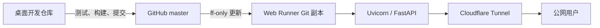

> 交接提示（2026-10-23）：本文含历史内容。正式架构为 React/FastAPI + Windows Worker + 飞书 Base；管理员使用飞书角色认证，无额外管理密码。以 docs/handover 下当前说明为准。

# PUDU Material Operations 前端与公网隧洞架构

本文说明 PUDU 营销物料管理系统当前的 React 前端、FastAPI 服务、Windows 运行节点、Cloudflare Tunnel 与公网域名之间的关系。文档不记录任何 App Secret、Tunnel Token、管理密码或飞书访问凭据。

> 状态基线：2026-10-08。生产环境、DNS 和运行任务可能发生变化，排障时仍应以实时健康检查、计划任务参数和 Runner 日志为准。

## 1. 总体结构

```mermaid
flowchart LR
    U[浏览器 / 飞书卡片] -->|HTTPS| CF[Cloudflare 边缘网络]
    D1[material.gaohongyuan.me] --> CF
    D2[pudu-material-operations.gaohongyuan.me] --> CF
    CF -->|Named Tunnel| T[cloudflared]
    T -->|HTTP 127.0.0.1:8501| API[Uvicorn + FastAPI]
    API --> SPA[React SPA 静态文件]
    API --> REST[/api/*]
    REST --> CACHE[本地 JSON / 图片缓存]
    REST --> QUEUE[飞书后台任务队列]
    QUEUE --> WORKER[Windows 后台 Worker]
    WORKER --> BASE[飞书多维表格]
```

公网没有直接开放 Windows 入站端口。`cloudflared` 从部署电脑主动连接 Cloudflare，Cloudflare 再把匹配域名的请求经 Named Tunnel 转发到本机 `127.0.0.1:8501`。

## 2. 请求链路

一次页面访问按以下顺序完成：

1. 用户访问 HTTPS 域名。
2. Cloudflare DNS 将域名代理到对应的 Named Tunnel。
3. Cloudflare 边缘节点把请求送入已建立的 Tunnel 连接。
4. 本机 `cloudflared` 将请求转发到 `http://127.0.0.1:8501`。
5. Uvicorn 运行 `request_web.api:api`。
6. FastAPI 根据路径返回 React 页面、静态资源、图片资源或 JSON API。
7. 需要写入业务数据的操作由 API 放入飞书后台任务队列，浏览器不直接完成复杂的飞书写入。

这套结构的关键边界是：

- 浏览器只访问同源的页面和 `/api/*`，不持有飞书密钥。
- FastAPI 监听 `127.0.0.1`，不直接暴露到局域网或公网。
- Cloudflare Tunnel 是公网入口，不承担业务计算和数据存储。
- 飞书多维表格是运行时业务数据库；静态 JSON 和图片缓存用于加速页面读取。
- 后台 Worker 负责可重试的飞书写入，页面入队成功后可以关闭。

## 3. React 前端

### 3.1 技术栈

| 层级 | 当前实现 |
| --- | --- |
| UI | React 19 |
| 语言 | TypeScript |
| 构建工具 | Vite |
| 源代码 | `request_web/frontend/src/` |
| 构建产物 | `request_web/frontend/dist/` |
| 构建命令 | `npm run build` |

`dist/` 会随正式版本一同提交。生产电脑不运行 Vite 开发服务器，而是由 FastAPI 直接提供已构建的 HTML、CSS 和 JavaScript。

### 3.2 页面路由

React 使用浏览器 History API 管理页面路径，FastAPI 对未知非 API 路径返回同一个 `dist/index.html`，再由前端决定显示哪个页面。

主要入口包括：

| 路径 | 页面 |
| --- | --- |
| `/request` | 物料申领 |
| `/cultural` | 文化周边申领 |
| `/management/allocation` | 配货工作台 |
| `/management/shipping-schedule` | 发货排期 |
| `/management/shipping-template` | 发货模板 |
| `/management/restock` | 采购补库 / 减库 |
| `/management/categories` | 品类管理 |
| `/management/models` | 型号管理 |
| `/management/languages` | 语种管理 |
| `/management/regions` | 战区管理 |

页面跳转不会启动新的后端服务，也不会更换 Tunnel。所有路径都进入同一个 FastAPI 实例。

### 3.3 静态资源与 API

FastAPI 当前承担四类内容：

- React 构建资源：`/static/*` 和 SPA 回退页面。
- 应用资源：`/app-assets/*`。
- 品类图片：`/category-assets/*`。
- JSON API：`/api/*`。

常用健康检查：

```text
http://127.0.0.1:8501/api/health
https://material.gaohongyuan.me/api/health
https://pudu-material-operations.gaohongyuan.me/api/health
```

正常响应为：

```json
{"status":"ok"}
```

### 3.4 管理页面会话

管理页面通过 `/api/admin/unlock` 校验密码，并写入同源 Cookie。当前管理员会话保存在 FastAPI 进程内存中，因此 Web 进程重启后需要重新解锁。两个公网域名的 Cookie 彼此独立，使用不同域名访问时也可能需要重新登录。

## 4. FastAPI 与本机 Web Runner

### 飞书工作台桌面端入口

飞书工作台「桌面端主页」应使用当前应用的工作台免登入口：

```text
https://pudu-material-operations.gaohongyuan.me/auth/feishu/workplace-start
```

桌面端保持「从主页跳转至新页面时在浏览器中打开」。应用在飞书客户端内
取得预授权码、校验企业身份，再通过一次性短时票据打开外部浏览器并写入
30 天会话 Cookie。无需新增安全设置中的回调 URL。移动端主页保持正式域名
直达链接，不要误改。工作台主页变更需在飞书开放平台保存并按要求发布。
旧域名 `material.gaohongyuan.me` 的 Cookie 与正式域名不共享，不应再用于工作台入口。

正式 Web 运行副本位于：

```text
%USERPROFILE%\PuduMaterialWebRunner\repo
```

运行环境和关键文件：

| 项目 | 位置 |
| --- | --- |
| Runner 根目录 | `%USERPROFILE%\PuduMaterialWebRunner` |
| Git 工作副本 | `%USERPROFILE%\PuduMaterialWebRunner\repo` |
| Python 环境 | `%USERPROFILE%\PuduMaterialWebRunner\repo\.venv` |
| 运行密钥副本 | `%USERPROFILE%\PuduMaterialWebRunner\secrets.toml` |
| Tunnel Token | `%USERPROFILE%\PuduMaterialWebRunner\cloudflare-token.txt` |
| Web 日志 | `%USERPROFILE%\PuduMaterialWebRunner\logs\web.log` |
| Tunnel 日志 | `%USERPROFILE%\PuduMaterialWebRunner\logs\tunnel.log` |

Web 启动命令的核心部分是：

```powershell
python -m uvicorn request_web.api:api --host 127.0.0.1 --port 8501
```

`scripts/run_local_web_app.ps1` 会在启动前检查 Runner 仓库是否干净，并尝试对 `master` 执行 `fetch` 和 `pull --ff-only`。GitHub 暂时不可用时，它会继续使用已经存在的干净副本，不会因为一次网络故障删除可运行版本。

## 5. Cloudflare Tunnel 与域名

### 5.1 Named Tunnel

Tunnel 运行命令的核心部分是：

```powershell
cloudflared tunnel --no-autoupdate --url http://127.0.0.1:8501 run --token-file <本机 Token 文件>
```

Tunnel Token 只保存在部署电脑，不写入 Git。Token 文件与运行密钥文件会限制为当前 Windows 用户可读写。

### 5.2 DNS 与 Public Hostname

自动配置模式会：

1. 校验公网域名属于所选 Cloudflare Zone。
2. 创建或复用 Named Tunnel。
3. 将 Tunnel ingress 指向 `http://127.0.0.1:8501`。
4. 创建启用代理的 CNAME，目标为 `<Tunnel-ID>.cfargotunnel.com`。
5. 获取运行 Token 并写入本机受保护文件。

自动配置所需的 Cloudflare API Token 应只具备 Tunnel 与 DNS 编辑权限。运行 Web 服务只需要 Named Tunnel 运行 Token，不需要长期保存 Cloudflare 管理 API Token。

### 5.3 当前域名状态

截至 2026-10-08，以下两个域名均能访问同一套 FastAPI 服务：

- `https://material.gaohongyuan.me`
- `https://pudu-material-operations.gaohongyuan.me`

双域名可以作为迁移兼容方案，但长期建议明确一个主域名，并将另一个域名做跳转或仅作为备用入口。否则管理员 Cookie、收藏夹、飞书卡片链接和故障排查记录会分散在两个主机名下。

## 6. Windows 计划任务

前端和 Tunnel 由两个独立计划任务管理：

| 计划任务 | 职责 |
| --- | --- |
| `PUDU Material Web App` | 更新 Runner、准备 Python 环境并启动 Uvicorn/FastAPI |
| `PUDU Material Cloudflare Tunnel` | 启动 cloudflared，将公网流量转发到本机 8501 端口 |

任务在用户登录时启动，隐藏运行，允许电池供电，错过启动后补跑，并配置异常重启。Web 与 Tunnel 分开运行，因此可以分别判断“本地应用故障”和“公网隧洞故障”。

## 7. 发布与更新链路



正式发布顺序应为：

1. 更新版本号。
2. 构建 React `dist/`。
3. 运行完整测试和缓存校验。
4. 重建部署启动器。
5. 提交并推送 GitHub `master`。
6. 同步 Web、提交 Worker、卡片 Worker 与缓存 Runner。
7. 验证本地和公网 `/api/health`。
8. 校验各 Runner 提交 SHA 与 GitHub `master` 一致。

仅看到 GitHub 推送成功、计划任务为 Running 或页面能打开，都不足以证明发布完整成功。

## 8. 故障定位

| 现象 | 优先检查 |
| --- | --- |
| 本地和公网都打不开 | `web.log`、Uvicorn 进程、8501 端口、本地健康检查 |
| 本地正常，公网打不开 | `tunnel.log`、cloudflared 进程、Tunnel Token、Cloudflare Public Hostname 和 DNS |
| 页面能打开但资源 404 | `request_web/frontend/dist/` 是否存在、构建后的资源名是否与 `index.html` 一致 |
| 页面能打开但 API 报错 | `/api/health`、FastAPI 日志、缓存文件、飞书配置 |
| 提交成功提示后业务数据未落库 | 后台任务队列、提交 Worker 日志和任务最终状态 |
| 管理页面反复要求密码 | FastAPI 是否重启、是否切换了公网域名、Cookie 是否属于当前主机名 |
| 更新后页面仍是旧版本 | Web Runner 的 Git SHA、浏览器静态资源、计划任务是否重启 |

建议按“本地健康检查 -> 公网健康检查 -> 页面静态资源 -> API -> 后台队列 -> 飞书最终数据”的顺序排查，不要一开始就修改 Tunnel 或 DNS。

## 9. 域名或电脑迁移

迁移到新电脑或更换域名时需要同步考虑：

- GitHub 仓库与 `master` 分支。
- `.streamlit/secrets.toml` 中的业务配置。
- Cloudflare Zone、Named Tunnel、Public Hostname 和 DNS CNAME。
- Web Runner 与 Tunnel 计划任务。
- 飞书卡片中生成的公网链接。
- 管理页面 Cookie 会因域名改变而失效。
- 本地和公网健康检查必须同时通过。

不要在两台电脑上同时运行会争抢后台队列的主节点。备用节点可以预先安装依赖和代码，但应保持 Web/Tunnel 或 Worker 停止，直到正式接管。

## 10. GitHub 仓库迁移状态

GitHub 主仓库已迁移为：

```text
https://github.com/G1026271140-spec/pudu-material-operations.git
```

2026-10-08 已将源代码配置、部署启动器默认值、Web Runner、提交 Worker 和缓存 Runner 统一切换到新仓库。旧仓库 `pudu-material-inventory` 已删除。迁移完成后应保持以下条件：

- 桌面开发仓库与各 Runner 的 `origin` 均指向新仓库。
- 各 Runner 的提交 SHA 与新仓库 `master` 一致。
- 本地和两个公网域名的 `/api/health` 均返回 `200` 和 `{"status":"ok"}`。
- 运行密钥仍只保存在本机，不进入 Git 仓库。

相关实现文件：

- [`request_web/api.py`](../request_web/api.py)
- [`request_web/frontend/src/Portal.tsx`](../request_web/frontend/src/Portal.tsx)
- [`scripts/run_local_web_app.ps1`](../scripts/run_local_web_app.ps1)
- [`scripts/run_cloudflare_named_tunnel.ps1`](../scripts/run_cloudflare_named_tunnel.ps1)
- [`scripts/install_local_web_app_task.ps1`](../scripts/install_local_web_app_task.ps1)
- [`deployment_launcher/cloudflare.py`](../deployment_launcher/cloudflare.py)
- [`docs/deployment_launcher.md`](deployment_launcher.md)
